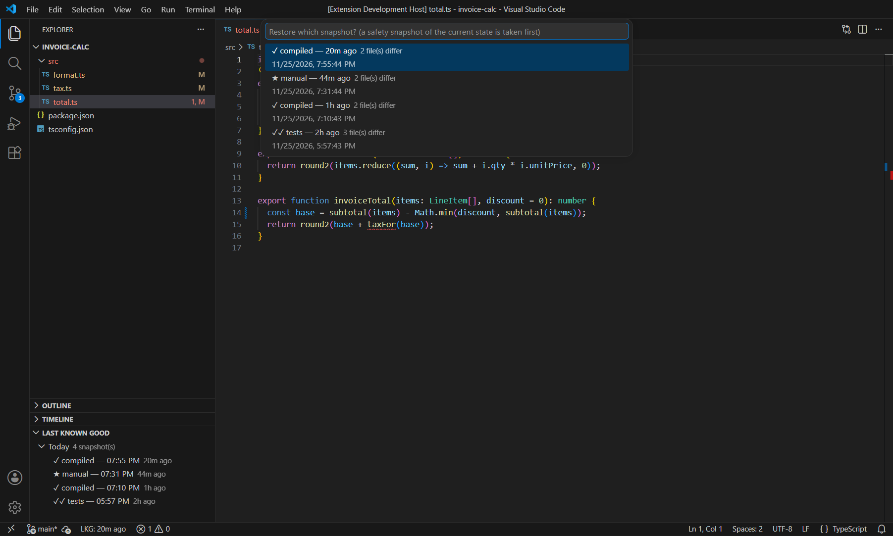
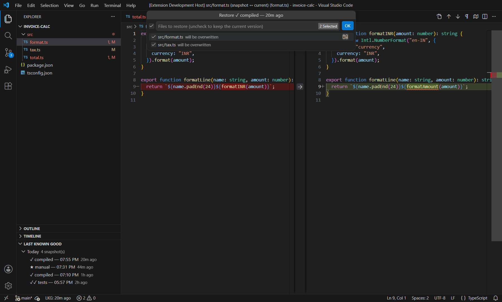
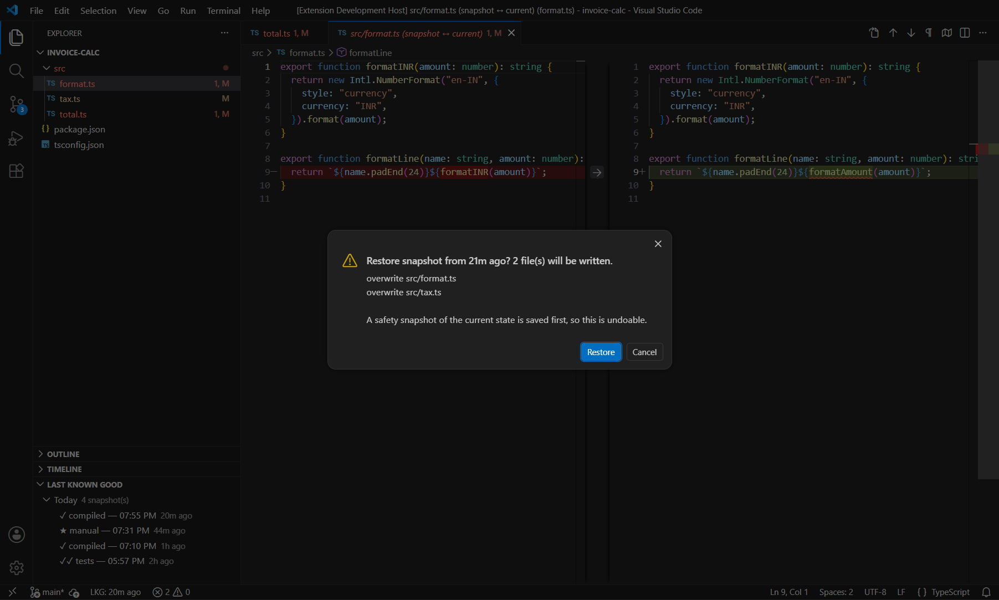
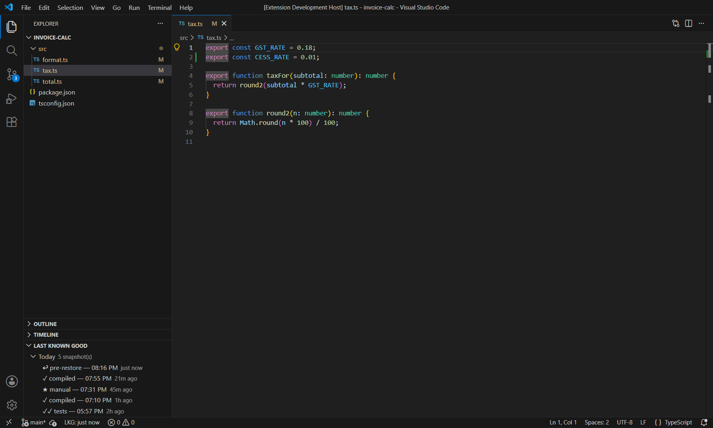

# Last Known Good

[](https://marketplace.visualstudio.com/items?itemName=atharvaawate.last-known-good)
[](https://marketplace.visualstudio.com/items?itemName=atharvaawate.last-known-good)

<!-- TODO before publishing: record the demo GIF (red squiggles → Restore → clean code) and embed it here, above the fold: -->
<!--  -->

*"It was working 40 minutes ago and I don't know which of my 15 changes broke it."*

Last Known Good snapshots your workspace when the code reaches a known-good
state and restores the most recent working state with one command. Snapshots
are invisible: they never appear in `git log`, `git status`, `git stash list`,
or any git GUI, and they never touch your index or working tree.

The extension never claims to know what "working" means — **you** define the
signal. Every snapshot is labeled by what triggered it, so you decide which to
trust:

| Badge | Trigger |
| --- | --- |
| ★ manual | You ran **Mark as Good** |
| ✓ compiled | Zero error diagnostics a few seconds after a save |
| ✓✓ tests / build | A task you designated exited with code 0 |
| ↩ pre-restore | Automatic safety snapshot taken before every restore |

## Screenshots

<table>
  <tr>
    <td width="50%"><a href="images/restore-picker.png"></a><br /><sub><b>1. Pick a snapshot</b>: each one labeled by what triggered it, with how many files differ. The timeline view and the <code>LKG: 20m ago</code> status bar item are on the left and bottom.</sub></td>
    <td width="50%"><a href="images/restore-files.png"></a><br /><sub><b>2. Review the files</b>: uncheck any file to keep your current version; the diff button opens snapshot ↔ current.</sub></td>
  </tr>
  <tr>
    <td width="50%"><a href="images/restore-confirm.png"></a><br /><sub><b>3. Confirm</b>: the exact file list, and a reminder that a safety snapshot is taken first.</sub></td>
    <td width="50%"><a href="images/restored.png"></a><br /><sub><b>4. Back to working code</b>: zero errors, and the broken state is kept as a <code>↩ pre-restore</code> snapshot.</sub></td>
  </tr>
</table>

## Install

Install it from the
[VS Code Marketplace](https://marketplace.visualstudio.com/items?itemName=atharvaawate.last-known-good),
or open Quick Open (`Ctrl+P` / `Cmd+P`) and run
`ext install atharvaawate.last-known-good`.

## Commands

- **Last Known Good: Mark as Good** — snapshot the current state (tracked
  changes *and* untracked files; `.gitignore` respected).
- **Last Known Good: Restore…** — pick a snapshot; see how many files differ;
  confirm the exact file list; restore.

The status bar shows `LKG: 4m ago` (time since the last snapshot); click it to
open the restore picker.

Restoring is a three-step, fully previewable flow: pick a snapshot, then
review the per-file checklist — every row has a diff button showing
snapshot ↔ current, and unchecking a file keeps your current version — then
confirm. A **Last Known Good** timeline view in the Explorer sidebar shows
every snapshot grouped by day; click one to restore it, right-click to
delete it.

## Settings

| Setting | Default | What it does |
| --- | --- | --- |
| `lastKnownGood.autoSnapshot.enabled` | `true` | Snapshot automatically when the workspace has zero error diagnostics shortly after a save |
| `lastKnownGood.autoSnapshot.debounceSeconds` | `4` | How long to wait after a save before checking diagnostics |
| `lastKnownGood.testTasks` | `[]` | Task names whose success creates a ✓✓ tests-passed snapshot |
| `lastKnownGood.buildTasks` | `[]` | Task names whose success creates a ✓✓ build-passed snapshot |
| `lastKnownGood.autoSnapshot.strictness` | `"errors"` | What must be absent for "clean": errors only, or `"errors-and-warnings"` |
| `lastKnownGood.autoSnapshot.excludeGlobs` | `[]` | Saves of files matching these globs never trigger an auto-snapshot |

Identical states are never snapshotted twice (dedupe by tree hash). Retention
keeps the newest 10 snapshots unconditionally, thins older ones to one per
hour for today and one per day beyond, and caps the total at 30.

## Safety model

- A **safety snapshot of the current state is always taken before restoring**,
  so every restore is itself undoable.
- Restore only writes files that exist in the snapshot. Files you created
  after the snapshot are left alone.
- Restores are byte-exact — no line-ending rewriting, even with
  `core.autocrlf=true`.
- Snapshots are plain git commits under hidden `refs/lkg/*` refs. If the
  extension vanished tomorrow, `git for-each-ref refs/lkg` +
  `git restore --source=<hash> -- .` gets your code back.
- No snapshots during merge/rebase/cherry-pick.
- No telemetry.

## Requirements

- The workspace root must be a git repository (the extension stays dormant
  otherwise).
- git ≥ 2.23 on your PATH.
- Multi-root workspaces: v1 snapshots only the first folder.

## Development

```
npm install
npm run compile   # bundle with esbuild → dist/extension.js
npm test          # tsc + node:test integration tests (real temp git repos)
```

Press F5 in VS Code to launch the Extension Development Host, then open any
git repository.
